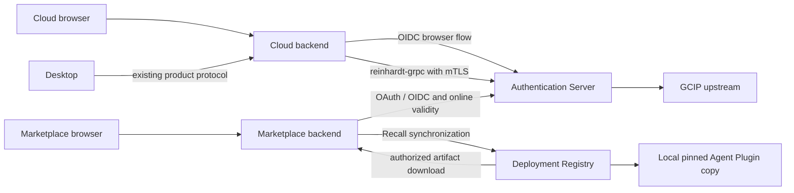

# Shared authentication and a standalone Marketplace

Status: all 33 design questions and the complete architecture are approved; implementation and PR creation were authorized on 2026-10-23. This document describes the target architecture; implementation evidence is recorded separately. The investigation baseline was `develop/0.1.0` at `eb559b1d3d`. Implementation reuses that worktree on `feat/auth-marketplace-standalone`, fast-forwarded to `origin/develop/0.1.0` at `37d427e09b` before source changes.

## Result and scope

Run the Marketplace as an independently built and deployed full-stack web service. Extract a shared Authentication Server for Cloud and Marketplace human sign-in. Use `reinhardt-grpc` for Cloud's private authentication integration, and standard OAuth 2.0 / OpenID Connect for both products' browser sign-in.

The Marketplace distributes Agent Plugins. Registry downloads and validates them, stores local copies, and pins them inside Agent versions. Existing same-Deployment sharing of Tenant Registry definitions is Shared Package functionality, even where current code still calls it `marketplace`. Extracting that module unchanged would not implement the intended product boundary.

Dedicated and Self-hosted Deployment sign-in remain independent in the initial rollout. Their Marketplace Connections stay optional. The existing one-codebase and Community/Enterprise boundaries remain: Community never depends on Enterprise, and GCIP types, persistence and adapters stay in Enterprise.

## Service boundaries



| Owner                    | Owns                                                                                                                                               | Does not obtain merely through shared authentication                                |
| ------------------------ | -------------------------------------------------------------------------------------------------------------------------------------------------- | ----------------------------------------------------------------------------------- |
| Authentication Server    | Aidash Accounts, login Links and retained association history, human authentication sessions, downstream token issuance, common Account Suspension | Tenant membership, resource policy, Publisher operations, agent/service credentials |
| Cloud / each Deployment  | Tenants, source-Identity Mappings, subjects, policies, Subject Credentials, Registry, Catalog Approvals, Runs and their origins                    | Authority from another linked Identity or another product                           |
| Marketplace              | Publishers, artifact versions, Libraries, Entitlements, Connections, Account Links and Recalls                                                     | Cloud Tenant creation or access to Cloud's internal tables                          |
| Existing Billing context | Existing Billing Account ownership and payment contracts                                                                                           | Automatic conversion of Identity-based ownership to common Account ownership        |

A shared physical PostgreSQL instance is permitted. Each service has its own schemas, database roles, credentials and migrations. Services do not read or write another service's tables at runtime and do not create foreign keys across ownership boundaries. Products may retain local Identity reference records for existing local ownership and authorization; these records are not the shared authentication source of truth.

The Marketplace must start and deploy without the Cloud process, Cloud browser shell or Cloud schema migrations. Shared infrastructure and the Authentication Server remain explicit dependencies. Product integration, including existing Billing integration, must use owned interfaces instead of composing the Cloud runtime or reading its tables.

## Accounts and authority

An Aidash Account identifies a person across the two products. An External Identity remains identified by issuer and subject, including the GCIP pool. Email equality never creates a Link or merges Accounts. A common Account itself grants no Tenant membership or product permission.

Adding a login Link requires fresh proof of both the existing Account and the target Identity. Initially there is no Account merge or Identity transfer between Accounts. Once an Identity has its first Account association, that association remains historical even after unlinking; reattachment is only to the original Account. A never-assigned legacy Identity still chooses its first Account during migration.

Unlinking requires fresh authentication through another enabled linked Identity and cannot remove the last usable login method. It revokes sessions sourced by the removed Identity but preserves local ownership, Mappings and admitted work. Existing work keeps its original Identity and Account provenance, and the original Account's Suspension remains applicable while the login Link is absent.

A Product Session records the Identity used to authenticate. A personal linked login cannot substitute for enterprise SSO required by a Tenant. Mappings are not combined across linked Identities; existing shared-pool and bound-pool restrictions remain in force.

Personal Marketplace Libraries and personal Publishers belong to the Aidash Account; Tenant Libraries remain Tenant-owned. Marketplace-only use creates no Cloud Personal Tenant. Cloud provisions a Personal Tenant on first Cloud use under its existing Tenancy Rules. Existing Billing owner references remain Identity-based, and linking does not transfer them.

## Sign-in, sessions and internal calls

The Authentication Server retains GCIP upstream for Google, passwords and enterprise SSO. It becomes the downstream issuer rather than implementing its own password or MFA verification. Initially only first-party clients are supported.

Both browser products use OIDC Authorization Code with PKCE. Their backends exchange codes and retain downstream access and refresh tokens; product JavaScript does not receive those tokens. The browser receives an opaque HttpOnly Product Session cookie scoped to its product origin. SSO uses authentication redirects rather than shared product cookies. Exact callback registration, issuer/audience/nonce validation, CSRF protection and client isolation are implementation requirements.

Browser Product Session and browser SSO defaults are twelve hours absolute and thirty minutes idle. Refresh does not extend a Product Session's absolute lifetime. Existing SSO is not fresh authentication for adding or removing login Links. Downstream refresh tokens rotate per product client/device family; confirmed inconsistent reuse invalidates that family and its Product Session. Safe response-loss retries must remain distinguishable from replay.

Desktop keeps its Cloud broker and product-local start/authorize/exchange/refresh/revoke protocol. It does not receive the shared Authentication Server's refresh token. Initial defaults stay five-minute access, thirty-day idle and ninety-day absolute lifetime, preserving successor-secret and response-loss retry behavior.

Cloud's private RPC path uses `reinhardt::grpc`, mTLS and authorization for each calling service. Product service credentials do not grant Account Suspension/restoration authority. The router namespace and DI interceptor are not authorization mechanisms. Certificate issuance, peer identity verification, rotation and service permissions are required infrastructure.

Initial research at Reinhardt revision `bb2562bc4839250d277a7ceecbf7fe5c18dd82c8` and upstream main `746e267ffc2edb75ee626d7508d273b526c387d6` found service registration and DI but no standard server mTLS configuration or dedicated client/channel API. The implementation adds those prerequisites in [Reinhardt PR #6876](https://github.com/kent8192/reinhardt-web/pull/6876) and pins its immutable runtime revision `b6a006a769ca340c22a51e67fef1bb4be1dc3039` in both workspaces. Cloud uses the facade transport and peer identity APIs; the implementation does not bypass the selected framework.

## Protected operations and lifecycle

Every new protected operation online-validates current authentication. An unexpired token or cached active result is insufficient if the Authentication Server cannot be reached. Authentication Server replicas must preserve the completed-stop admission guarantee rather than returning stale active state. Public Marketplace listing/detail metadata remains public; Library access, purchases, publishing and artifact acquisition require authentication and applicable authorization.

| Event                                         | Interactive effect                                | Effect on admitted durable work                                                    |
| --------------------------------------------- | ------------------------------------------------- | ---------------------------------------------------------------------------------- |
| Ordinary logout                               | Ends the current product/device session           | Continues under original authority                                                 |
| Explicit all-products logout                  | Ends all product/device sessions                  | Continues under original authority                                                 |
| Session expiry or migration session cutoff    | Requires a new login                              | Does not itself stop work                                                          |
| Login Link removal                            | Revokes sessions from that Identity               | Does not itself stop work or change its provenance                                 |
| Source Identity Disablement                   | Refuses source-derived authentication             | Refuses the next execution boundary; no automatic resume from definite disablement |
| Aidash Account Suspension                     | Refuses new protected operations for that Account | Refuses the next relevant boundary, including origins whose login Link was removed |
| Authentication Server unreachable             | Denies new protected operations                   | Pauses at the next human-origin boundary, retaining state                          |
| Local Mapping, credential or policy withdrawn | Denies operations relying on it                   | Refuses the next boundary under that original authority                            |

Interactive validity checks the Product Session, Account and source Identity as applicable. Durable-origin validity checks the original source, relevant Account stop and product-local authority without requiring the initiating browser/Desktop session or active login Link to remain alive. Account-unassigned legacy work is still checked by its original Identity and local authority; the absence of an Account alone neither stops it nor allocates an Account automatically.

A short operation already admitted before logout or a stop may finish and commit afterward. The guarantee is refusal of later admissions, not a distributed commit lock across services. Runs recheck at model/tool boundaries. Every protected stream frame is a separate admission with remote authentication and local authority checks; denial/unavailability closes the connection and discards buffered data not yet admitted for transmission. Reconnection rechecks authority. Idle polling does not replace frame checks, and an already-admitted frame may finish under the same rule as other short operations.

Transient authentication-outage pauses may auto-resume only after recovery and revalidation of the original Identity, Mapping, credential and policy. Another linked Identity is never substituted. Definite stops or withdrawn authority do not auto-resume. GCIP status retains five-minute successful freshness and failed-lookup grace only until fifteen minutes from the last success. This upstream grace is distinct from immediate refusal when the Authentication Server itself is unreachable. A known explicit stop overrides an older positive upstream result.

Only Authentication Administrators suspend or restore common Accounts; that role grants no product authority. Product administrators keep their local roles. Restoration revives neither old sessions nor Runs automatically: fresh sign-in and authorized manual resume are required where relevant. Lost-login recovery initially uses GCIP/upstream recovery only, without email-assertion bypass or administrator assignment of a replacement Identity.

## Distribution and Recall

The public catalog includes listings, descriptions, prices and Declared Permissions, not protected artifact contents. Artifact acquisition and updates are authorized by Marketplace from authoritative Entitlements. A caller's claim of purchase, a Connection credential or mTLS alone does not prove ownership or an unmodified runtime. Actual storage/delivery access must obey the acquisition authorization, including paths that bypass the UI.

Registry downloads the authorized artifact, validates its contents and immutable version/digest, then stores a local copy. Agent versions pin that copy and require the applicable local Catalog Approval. No separate Registry definitions are created merely by adding an Agent Plugin. Artifact container format and storage backend are reversible implementation choices within these constraints.

Delivering an executable copy to a Self-hosted Deployment controlled by the person running it cannot guarantee prevention of that person's unauthorized copying or execution. Signatures can establish provenance/integrity to a compliant verifier but cannot force it to run. Aidash-operated Cloud and Dedicated can enforce their runtime checks. This enforcement limit does not change the Entitlement's stated rights. When strict metered or time-limited service enforcement is required, keep the protected core operation behind an authorized remote MCP/API; local copies do not provide that guarantee.

A Recall names a plugin version that must not start new Runs. Once learned, it blocks new Runs of Agent versions carrying that version, including while disconnected. Recall alone neither cancels existing Runs nor deletes installed copies. Communication loss uses the last synchronized Recall state, and removing a Connection does not clear known Recalls. An unknown Recall can only apply after it is received; offline execution deliberately has no instantaneous new-Recall delivery guarantee. People running modified Self-hosted Deployments can bypass local Recall enforcement just as they can bypass other local checks.

Installed local copies do not need the Marketplace for each execution. A plugin's remote MCP/API dependencies remain its own dependencies; Marketplace availability is distinct from Authentication Server availability for Cloud human-origin work.

## Migration and delivery constraints

1. Use the pinned Reinhardt gRPC transport and service authentication support, and provision/verify the certificate lifecycle before private RPC cutover.
2. Make the Authentication Server capable of checking legacy Identities and durable origins before Cloud operations depend on it. Preserve External Identity UUIDs, issuer/subject pairs, Mappings, Subject Credentials, Personal Tenants, Billing owner references and Run origins.
3. Assign common Accounts lazily at the first new sign-in, with an explicit choice of new Account or fresh proof of an existing Account. Do not eagerly allocate one Account per legacy Identity: the no-merge rule would then prevent those Identities from joining one Account later.
4. Invalidate old browser/Desktop sessions at cutover while preserving admitted work. First Account assignment establishes retained Account provenance for that Identity's existing work; later unlink does not replace it.
5. Deliver independent Marketplace Pages service startup, migrations and artifact distribution. Keep old Shared Package functionality distinct. Limit the initial shared-auth sign-in rollout to Cloud and Marketplace.

These are prerequisite and compatibility constraints, not a claim that a migration or deployment has run. The implementation uses independent generated projects as described below. Cutover and rollback must not restore an older path that ignores current stops; production update/backup procedures must also preserve the existing ADR 0082 contract.

## Implementation acceptance criteria

The following are acceptance contracts. Local automated evidence, hosted CI and live provider/cluster acceptance are recorded separately in PR #507.

| Area                              | Required evidence                                                                                                                                                                                                  |
| --------------------------------- | ------------------------------------------------------------------------------------------------------------------------------------------------------------------------------------------------------------------ |
| Standalone product                | Build/start Marketplace without the Cloud process, Cloud browser shell or Cloud schema migration execution; exercise public catalog, shared sign-in and already-entitled artifact acquisition                      |
| No Cloud provisioning side effect | Marketplace-only signup/sign-in creates no Cloud Personal Tenant; first eligible Cloud use provisions it once                                                                                                      |
| Ownership boundary                | Service roles cannot read/write the other service's tables; migrations contain no cross-service FK; local reference records retain existing UUIDs                                                                  |
| RPC boundary                      | Invalid peers, wrong service identity and insufficient service permission fail; an ordinary Cloud client cannot suspend/restore common Accounts; certificate rotation works                                        |
| First Account assignment          | Never-assigned legacy Identity can choose new/existing Account with required proof; matching email alone never links                                                                                               |
| Unlink/relink history             | Link A/X, unlink X using another enabled Identity, reject attachment to B even with fresh proof, allow proven reattachment to A, and retain local ownership references                                             |
| Legacy durable migration          | Invalidate old browser/Desktop sessions while an Account-unassigned legacy Run continues after original Identity/local-authority checks; do not allocate an Account just to check the Run                          |
| Logout versus work                | Ordinary/global logout refuses affected sessions while existing Run boundaries continue under original source; a later Identity disable, Account stop or local withdrawal blocks that work                         |
| Unlink versus work                | X-derived work keeps X and original Account A while X is unlinked; X disablement or A Suspension still blocks its next boundary; do not substitute another linked Identity                                         |
| Enterprise provenance             | A personal linked login cannot use bound-pool enterprise Mappings or revive work stopped under an enterprise Identity                                                                                              |
| Stop ordering                     | Admissions after a completed stop fail; already-admitted short operations may finish, including writes committed afterward                                                                                         |
| Outage behavior                   | Authentication Server outage denies new protected operations and pauses human-origin work; public metadata remains readable with its own dependencies healthy; transient-only recovery rechecks original authority |
| Streams                           | Stop/unavailability rejects later frame admissions, discards unadmitted buffers and closes the stream; cursor reconnection rechecks authority                                                                      |
| Session/refresh compatibility     | Enforce accepted lifetime bounds, explicit link reauthentication and token-family scope; distinguish response loss from inconsistent reuse; preserve Desktop protocol                                              |
| Artifact boundary                 | Reject unauthorized downloads/updates and malformed/digest-mismatched artifacts; verify pinned-copy execution under local approval without refetching from Marketplace                                             |
| Recall persistence                | Learned Recall blocks new Runs after communication loss and Connection removal; an offline-issued Recall applies on resynchronization without promising earlier delivery                                           |
| Enforcement claims                | Demonstrate server-side acquisition restrictions; never represent local signatures, mTLS or Recall as proof against a modified Self-hosted runtime                                                                 |
| Source/build boundary             | Community builds without Enterprise; GCIP code/data remains Enterprise; shared dependencies stay aligned across the two workspaces                                                                                 |

## Implemented project layout

Each product is one generated Reinhardt Pages project:

```text
enterprise/
  auth/
    Cargo.toml, build.rs, Makefile.toml, Dockerfile, static/
    src/bin/manage.rs
    src/client/lib.rs
    src/config/{apps,settings,urls}.rs
    src/apps/authentication/{client,server,server_fn,services,urls}.rs
    src/apps/authentication/{client/components,server,server_fn,services,urls}/
    src/apps/authentication/serializers.rs
  marketplace/
    # Same project/app layout, with the distribution app.
```

The layout follows actual `reinhardt-admin startproject --with-pages` and
`startapp --with-pages` output from the pinned framework templates. The generated
`build.rs` supplies client/server aliases; target-specific modules share typed
serializers and `#[server_fn]` declarations. The project registers the app once
through `src/config/urls.rs`, with the inventory-driven Pages entry point at
`src/client/lib.rs` and specialized native commands at `src/bin/manage.rs`.
There are no separate frontend/backend projects or runtime images.

Views use `page!`; app-owned hooks manage state and effect cleanup. Marketplace
forms use `form!` with `use_form`/`use_form_action`, and scoped resources discard
stale protected reads. Form initialization is independent of parent render tracking.
Browser data and mutations use generated typed `server_fn` stubs. Native adapters
inject the existing owning service and HTTP request and retain its cookie/CSRF,
rate-limit, source lifecycle and Product Session policies in process. OIDC,
gRPC/mTLS, Registry and download protocol endpoints remain external interfaces.
No client-selected arbitrary path is accepted by a server function. Product
access/refresh tokens stay native; GCIP's transient upstream proof stays in the
Enterprise sign-in bridge.

Each product builds native and WASM from one Cargo package in the Enterprise
workspace and packages its assets and executable in one image. Rust uses
`enterprise/Cargo.lock`; wasm-pack and Python assemble static assets without
Node.js or a JavaScript package manifest. Browser E2E uses the native WebDriver
fixtures in `reinhardt-test/src/fixtures/wasm/e2e.rs`. Existing crate names,
migration labels, source references and protocol URLs are retained. Auth selects
only authentication/JWKS and GCIP adapters; Cloud explicitly selects its
`cloud-adapters`/`cloud` features. Architecture gates check each service-only
production graph for Runtime, Harness, NATS and Cloud-server dependencies.

The owning app modules and their real HTTP/PostgreSQL contracts implement
ADRs 0083–0089; Cloud's existing browser/Desktop/source-lifecycle tests also own
ADR 0090 compatibility. Marketplace and Registry acceptance cases own ADRs
0091–0092, including persisted acquisition deadlines, verify/pin, Recall and
Connection removal. Browser contracts exercise actual Pages WASM with real native services and
PostgreSQL; only upstream GCIP/key/status dependencies use controlled fixtures. They do not prove live GCIP or payment-provider
acceptance. Service role/FK tests apply the distributed bootstrap/seal scripts
to a shared physical PostgreSQL database with no Cloud schema or migrations.

`enterprise/compose.yaml` exposes separate Auth and Marketplace profiles with
owner migration, ledger sealing and runtime-only secret mounts. Cloud's GCP
controller and chart accept an explicit common-auth profile with private mTLS
files mounted on both server and worker. The services retain independent image
and release lifecycles; see the deployment guide for exact configuration.

Use the per-product READMEs and the
[deployment guide](../enterprise/deploy/standalone-service/README.md) for current
build commands, owner/runtime credentials, certificate configuration and image
paths. Production cutover, rebuilt release-image provenance, hosted CI and live
GCIP/cluster/payment evidence must be reported independently of local tests.

## Decision records

- [ADR 0083: common accounts and local product authority](adr/0083-aidash-accounts-share-authentication-while-product-authority-stays-local.md)
- [ADR 0084: sign-in proof, provenance and original Account association](adr/0084-linked-sign-in-methods-retain-their-own-authority.md)
- [ADR 0085: logout, online checks, operation boundaries and outages](adr/0085-product-sessions-have-local-logout-and-online-revocation-checks.md)
- [ADR 0086: unlinking, disablement scopes and recovery](adr/0086-identity-links-and-upstream-disablement-have-separate-scopes.md)
- [ADR 0087: browser OIDC, backend tokens and session bounds](adr/0087-browser-sign-in-uses-oidc-and-product-backends-keep-tokens.md)
- [ADR 0088: legacy migration and stable local references](adr/0088-legacy-identities-join-common-accounts-without-replacing-local-references.md)
- [ADR 0089: Reinhardt gRPC, data ownership and rollout scope](adr/0089-authentication-services-use-reinhardt-grpc-and-own-their-data.md)
- [ADR 0090: Desktop compatibility](adr/0090-desktop-keeps-the-cloud-broker-and-product-local-sessions.md)
- [ADR 0091: acquisition enforcement and local-copy limits](adr/0091-marketplace-enforces-acquisition-without-promising-local-copy-drm.md)
- [ADR 0092: offline Recall semantics](adr/0092-recalls-preserve-known-stops-without-requiring-online-execution.md)

Existing constraints: [ADR 0032: Community/Enterprise workspaces](adr/0032-enterprise-is-a-separate-cargo-workspace.md), [ADR 0072: pinned Agent Plugin copies](adr/0072-an-agent-plugin-is-a-pinned-copy-inside-the-agent-version-and-adds-no-registry-definitions.md), [ADR 0082: production update backups](adr/0082-production-updates-take-a-pre-update-backup-that-excludes-the-home-recovery-ledger.md).
